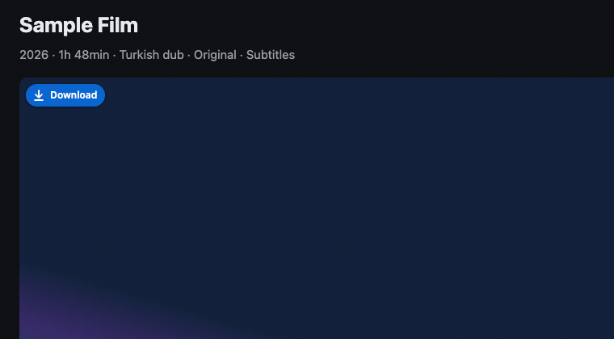
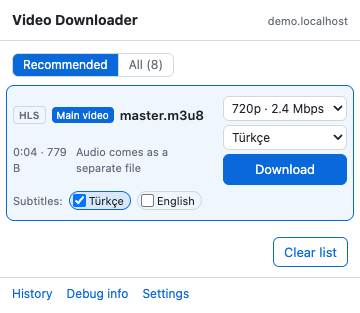
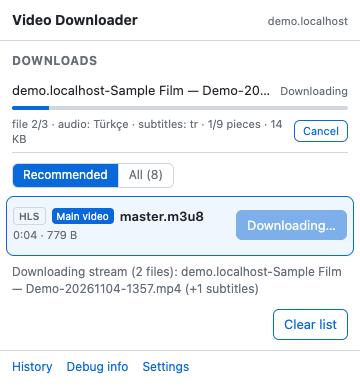
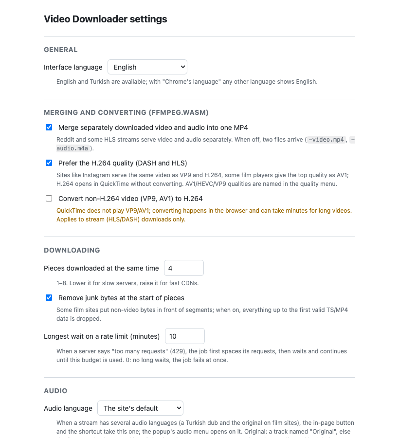

# Video Downloader (Chrome and Firefox extension)

[Türkçe](README.tr.md)

A Manifest V3 extension for Chrome and Firefox that downloads the videos playing on a page:
progressive files (MP4/WebM), HLS and DASH streams, with their subtitles. It
works inside third-party player iframes (embedded players), merges separate audio
and video into one MP4 in the browser (ffmpeg.wasm), and puts a small
download button on top of videos.

It is not published in the Chrome Web Store or listed on addons.mozilla.org: in
Chrome you load it as an unpacked extension, in Firefox you install the signed
`.xpi` from the releases. DRM-protected content (Netflix, Disney+, YouTube Premium …) cannot
be downloaded and is out of scope; YouTube and live streams are not supported.

<p align="center"></p>

| Popup | While downloading | Settings |
|---|---|---|
|  |  |  |

The images come from the demo fixture page (`npm run screenshots`), not from a real site.

## Install

### Chrome

1. Download the latest `video-downloader-<version>.zip` from
   [Releases](https://github.com/talhauncu/video-downloader-extension/releases) and unzip it,
   or clone this repository.
2. Open `chrome://extensions` and turn on **Developer mode** (top right).
3. **Load unpacked** → choose the folder (the one with `manifest.json`).
4. Pin the extension and click its icon on a page with a video.

After updating the files, press **Reload** on the extension's card. The
extension id is fixed (`dnbedddlffjlpbmgpdmnegngpkejbbjn`, from the `key` in
`manifest.json`), so settings, history and the shortcut survive moving the
folder.

### Firefox

Firefox 140 or newer.

1. Download the latest `video-downloader-<version>.xpi` from
   [Releases](https://github.com/talhauncu/video-downloader-extension/releases)
   (signed by addons.mozilla.org, not listed there).
2. Open it in Firefox (drag it onto a window, or **File → Open File**) and
   confirm the installation. Firefox updates nothing by itself: install the
   next release's `.xpi` the same way.

To try a checkout without signing: `npm run build:firefox`, then
`about:debugging` → **This Firefox** → **Load Temporary Add-on** →
`dist/firefox/manifest.json` (gone after a restart).

In Firefox the faster multi-threaded conversion to H.264 is not available
(Firefox does not isolate extension pages); conversion uses the
single-threaded core.

## Use

- **Popup** (toolbar icon): the **Recommended** view shows the page's main
  video first (the film the player plays, or the open reel), other real
  videos below it, and ads, neighbouring reels and unmatched streams folded
  under **Other**. **All** lists every captured entry. Streams offer a quality
  menu, and an audio menu when there are several languages (a dub and the
  original).
- **In-page button**: hovering a video shows a small **Download** button at
  its top-left corner (also in iframe players and full screen). One quality
  downloads at once, several open a menu. While a stream downloads the button
  shows a progress ring; hovering it shows the file, progress and time left,
  and turns it into a cancel button (two clicks). Ads get no button.
- **Sites with an extractor** (Instagram, X, Facebook, Vimeo — also its players embedded in other sites): the list shows one complete file
  per video (video and audio together) titled with the user and the post's
  text, instead of the player's separate stream pieces; the in-page button
  downloads the post it sits in.
- **Toolbar indicator**: while downloads run, the icon shows the overall
  progress on every tab; downloads go on when their page is reloaded or closed.
- **Queue and notifications**: at most two downloads the extension runs itself
  (streams, and plain files it converts or embeds subtitles into) go at once
  (setting: 1–4); the others wait as **Queued** and start in turn. When one
  ends, a system notification says so (click it to show the file). A download
  that fails keeps what it downloaded for an hour in the same browser session:
  downloading it again continues from there.
- **Subtitles**: HLS and DASH subtitle tracks, `<track>`s and subtitle files
  on the page show up as chips; the preferred languages are ticked in advance
  and download next to the video as `<name>-<lang>.srt` (or `.vtt`), or are
  embedded into the MP4.
- **Alt+Shift+D** downloads the best video of the open tab (change it at
  `chrome://extensions/shortcuts`).
- **History** lists recent downloads (click to show in Finder/Explorer).
  **Debug info** copies a technical summary for bug reports: no cookies, no page title, and addresses are
  masked (query values and long tokens). File names can still contain a page title; read it before posting.

### Settings

Interface language (Chrome's, English, Türkçe) · merging and H.264 conversion
· preferring H.264 qualities · parallel pieces · junk-byte trimming · the
rate-limit waiting budget · audio language (site default, original, Turkish,
English) · subtitle languages, format and embedding · folding ads · the
in-page button (on hover, always, off; hidden sites) · file name template
(`{site}` `{title}` `{date}` `{time}` `{quality}` `{id}`) · a folder inside
Downloads (`{site}` `{date}`, e.g. `VideoDownloader/{site}`) · downloads at
once · notifications · history size.

## Permissions

| Permission | Why |
|---|---|
| `webRequest`, host access to all sites | See the media requests a page makes (MP4, playlists, segments, subtitles) and their sizes. |
| `declarativeNetRequest` | Send the player's Referer/Origin with the extension's own requests; many media servers require it. Rules are temporary. |
| `offscreen` | Run long stream downloads, decryption, remuxing and ffmpeg.wasm outside the service worker (Chrome only; Firefox's background page does this itself). |
| `downloads` | Save files and show them in their folder. |
| `notifications` | Say when a download the extension runs is done or has failed (can be turned off in the settings). |
| `storage` | Settings, the per-tab list, job state and history. |
| `tabs`, `activeTab` | Know which tab a request belongs to and read its title for file names. |
| `scripting` | Run the site extractors on their sites (Instagram on instagram.com, X on x.com and twitter.com, Facebook on facebook.com, Vimeo on vimeo.com and in its embedded players). |

## Responsible use

Use the extension for videos you are allowed to download: your own, openly licensed ones, or where the
site or the rights holder permits it. It does not break DRM or other copy protection, and it is not
meant for redistributing other people's work. You are responsible for following the terms of the sites
you use and the copyright law where you live.

## Privacy

No telemetry, no analytics, no remote servers of ours. The extension only
talks to the sites you visit, with the headers their players use. Settings
sync through your Chrome account (`chrome.storage.sync`); everything else stays
in the browser.

## Development

Requirements: Node 22+ (CI uses 24); ffmpeg only to regenerate test media.

```bash
npm install
npx playwright install chromium firefox --no-shell
```

| Command | What it does |
|---|---|
| `npm test` | Unit tests (`node --test`) |
| `npm run e2e` | Playwright e2e tests: the extension in a real Chromium (`test/e2e`) and its Firefox build in Firefox (`test/e2e-firefox`) against a local fixture server |
| `npm run lint` | ESLint and Prettier check |
| `npm run typecheck` | `tsc --checkJs` over `src/` |
| `npm run check:vendor` | Checks that `src/vendor/` holds the npm packages' files unchanged (SHA-256) |
| `npm run format` | Prettier, writing |
| `npm run package` | Builds `dist/video-downloader-<version>.zip` (what a release contains); with `-- --firefox` also the Firefox zip |
| `npm run build:firefox` | Builds the Firefox version in `dist/firefox/` |
| `npm run fixtures` | Regenerates `test/fixtures/media` with ffmpeg |
| `npm run screenshots` | Regenerates the README images in `docs/images/` (demo fixture page, English and Turkish; needs ffmpeg for the GIFs) |
| `npm run serve` | Fixture server at `http://127.0.0.1:8787` for manual tries |

A pre-commit hook (simple-git-hooks + lint-staged) runs ESLint and Prettier
on staged files. There is no build step: the files are loaded as they are.
[ARCHITECTURE.md](ARCHITECTURE.md) explains how the parts fit together;
[CONTRIBUTING.md](CONTRIBUTING.md) how to work on it; the changes are in
[CHANGELOG.md](CHANGELOG.md).

## Roadmap

| Stage | Scope | Status |
|---|---|---|
| 0–5 | Skeleton and tests; network capture and plain files; DOM scan; HLS (AES-128, TS→MP4); DASH and separate audio; ffmpeg.wasm merge/convert; settings, history, shortcut | ✅ |
| 1a, 1b | Embedded players: the player frame's request context, disguised playlists, junk bytes, rate limits, token expiry | ✅ |
| 2a, 2b | Matching and a clean list (main video, ads folded); the in-page download button | ✅ |
| 3 | Subtitles (HLS, DASH, page tracks; .srt/.vtt; embedding) and the audio language (dub or original) | ✅ |
| 4a | Open-source readiness: license, docs, English/Turkish interface, lint and type checks, release packages | ✅ |
| 4b | Site extractor architecture (definitions under `src/sites/`, guide in `docs/sites.md`); README images | ✅ |
| 5a | X (Twitter): one complete MP4 per video and GIF, the post's text as the title | ✅ |
| 5b | Facebook: Reels, Watch and videos in posts as one complete MP4 (or merged DASH) each | ✅ |
| 5c | Vimeo: on vimeo.com and in players embedded in other sites, the largest MP4 or the HLS master | ✅ |
| 6a | Download queue (N at once), notifications, a folder inside Downloads, continuing a failed stream | ✅ |
| 6b | Performance: multi-threaded ffmpeg for H.264 conversion; plain files converted and given embedded subtitles too | ✅ |
| 6c | Firefox: the same features in Firefox 140+, a signed `.xpi` in the releases | ✅ |

## License

MIT for this project's code ([LICENSE](LICENSE)). The packaged extension
includes ffmpeg.wasm's core, which is GPL-2.0-or-later; see
[THIRD_PARTY_LICENSES.md](THIRD_PARTY_LICENSES.md).
