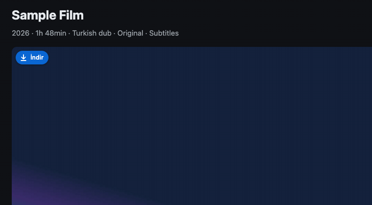
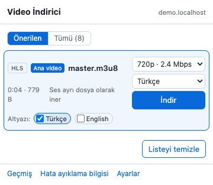
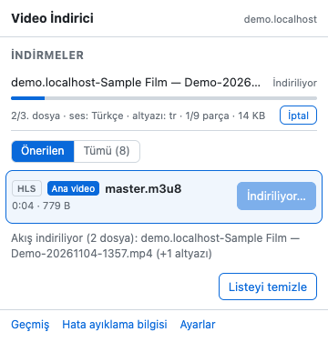
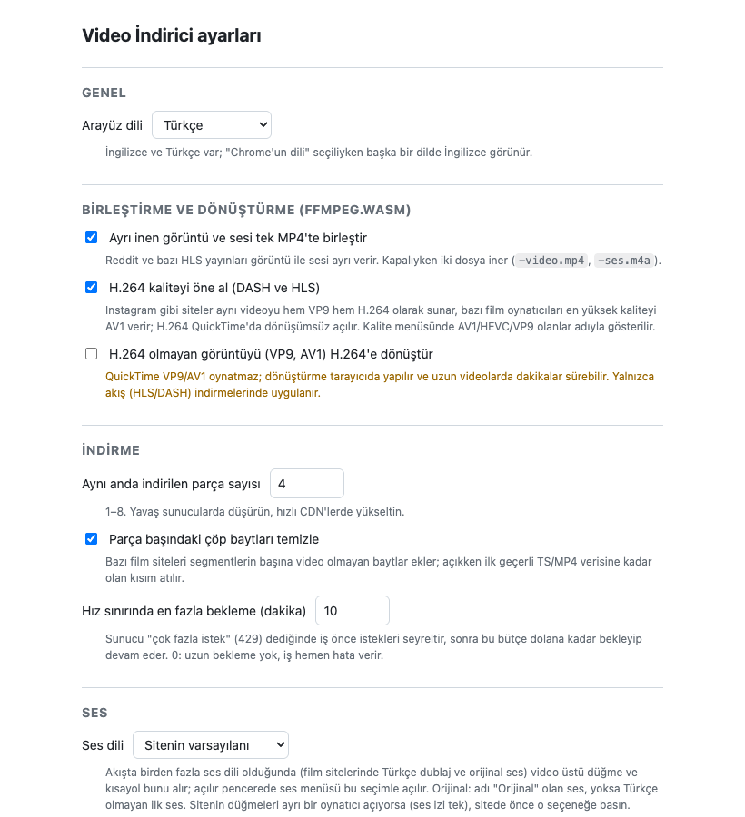

# Video İndirici (Chrome eklentisi)

[English](README.md)

Sayfada oynayan videoları indiren bir Manifest V3 Chrome eklentisi: düz
dosyalar (MP4/WebM), HLS ve DASH akışları ve altyazıları. Üçüncü taraf oynatıcı
iframe'lerinin içinde de çalışır (gömülü oynatıcılar), ayrı gelen görüntü ve sesi
tarayıcıda tek MP4'te birleştirir (ffmpeg.wasm) ve videoların üzerine küçük bir
indirme düğmesi koyar.

Chrome Web Mağazası'nda yayınlanmaz; "Paketlenmemiş öğe yükle" ile kullanılır.
DRM'li içerik (Netflix, Disney+, YouTube Premium …) teknik olarak indirilemez ve
kapsam dışıdır; YouTube ve canlı yayınlar desteklenmez.

<p align="center"></p>

| Açılır pencere | İndirme sürerken | Ayarlar |
|---|---|---|
|  |  |  |

Görseller demo fixture sayfasından üretilir (`npm run screenshots`), gerçek bir siteden değil.

## Kurulum

1. [Releases](https://github.com/talhauncu/video-downloader-extension/releases) sayfasından son
   `video-downloader-<sürüm>.zip`'i indirip açın ya da bu repoyu klonlayın.
2. `chrome://extensions` sayfasını açın, sağ üstten **Geliştirici modu**'nu açın.
3. **Paketlenmemiş öğe yükle** → klasörü seçin (`manifest.json`'un olduğu klasör).
4. Eklentiyi sabitleyin, videolu bir sayfada simgesine tıklayın.

Dosyalar değişince eklentinin kartındaki **Yeniden yükle** düğmesine basın.
Eklentinin kimliği sabittir (`dnbedddlffjlpbmgpdmnegngpkejbbjn`, `manifest.json`
içindeki `key` sayesinde); klasörü taşısanız da ayarlar, geçmiş ve kısayol
korunur. Eşleşen özel anahtar `~/.config/video-downloader-extension/key.pem`
dosyasındadır ve yalnızca `.crx` paketlemek için gerekir; repoda değildir.

## Kullanım

- **Açılır pencere** (araç çubuğu simgesi): **Önerilen** görünümde en üstte
  sayfanın ana videosu (oynatıcının çaldığı film ya da açık reel), altında diğer
  gerçek videolar; reklamlar, komşu reel'ler ve eşleşmeyen akışlar **Diğer**
  altında katlıdır. **Tümü** yakalanan her şeyi listeler. Akışlarda kalite
  menüsü, birden çok dil varsa (dublaj ve orijinal) ses menüsü vardır.
- **Video üstü düğme:** fare bir videonun üzerindeyken sol üst köşesinde küçük
  bir **İndir** düğmesi çıkar (iframe oynatıcılarda ve tam ekranda da). Tek
  kalite hemen iner, birden çoksa menü açılır. Akış inerken düğme ilerleme
  halkası gösterir; üzerine gelince dosya, ilerleme ve kalan süre görünür,
  düğme iptale döner (iki tıklama). Reklamlarda düğme çıkmaz.
- **Araç çubuğu göstergesi:** indirme sürerken simge tüm sekmelerde toplam
  ilerlemeyi gösterir; sayfa yenilense ya da kapansa da indirme sürer.
- **Altyazılar:** HLS ve DASH altyazı izleri, sayfadaki `<track>`'lar ve
  altyazı dosyaları kutucuk olarak görünür; tercih edilen diller önceden
  işaretlidir, videonun yanına `<ad>-<dil>.srt` (ya da `.vtt`) olarak iner ya da
  MP4'e gömülür.
- **Alt+Shift+D**: açık sekmedeki en iyi videoyu indirir
  (`chrome://extensions/shortcuts` sayfasından değiştirilebilir).
- **Geçmiş** son indirmeleri listeler (tıklayınca Finder'da gösterir).
  **Hata ayıklama bilgisi** hata bildirimi için teknik özeti kopyalar: çerez ve sayfa başlığı içermez,
  adresler maskelenir (sorgu değerleri ve uzun token'lar). Dosya adlarında sayfa başlığı geçebilir;
  yapıştırmadan önce okuyun.

### Ayarlar

Arayüz dili (Chrome'un dili, English, Türkçe) · birleştirme ve H.264'e
dönüştürme · H.264 kaliteyi öne alma · paralel parça sayısı · çöp bayt
temizliği · hız sınırında bekleme bütçesi · ses dili (sitenin varsayılanı,
orijinal, Türkçe, İngilizce) · altyazı dilleri, biçimi ve gömme · reklamları
katlama · video üstü düğme (fare üzerindeyken, her zaman, kapalı; gizlenecek
siteler) · dosya adı şablonu (`{site}` `{title}` `{date}` `{time}` `{quality}`
`{id}`) · geçmiş sınırı.

## İzinler

| İzin | Neden |
|---|---|
| `webRequest`, tüm sitelere erişim | Sayfanın yaptığı medya isteklerini (MP4, playlist, segment, altyazı) ve boyutlarını görmek. |
| `declarativeNetRequest` | Eklentinin kendi isteklerine oynatıcının Referer/Origin'ini eklemek; çoğu medya sunucusu bunu ister. Kurallar geçicidir. |
| `offscreen` | Uzun akış indirmeleri, şifre çözme, remux ve ffmpeg.wasm'ı service worker dışında çalıştırmak. |
| `downloads` | Dosyaları kaydetmek ve klasörde göstermek. |
| `storage` | Ayarlar, sekme listesi, iş durumu ve geçmiş. |
| `tabs`, `activeTab` | İsteğin hangi sekmeye ait olduğunu bilmek, dosya adı için başlığı okumak. |
| `scripting` | instagram.com'da Instagram çıkarıcısını çalıştırmak. |

## Sorumlu kullanım

Eklentiyi indirme hakkınız olan videolar için kullanın: kendi videolarınız, açık lisanslı içerik ya da
sitenin veya hak sahibinin izin verdiği durumlar. Eklenti DRM'i ya da başka kopya korumalarını aşmaz;
başkalarının eserlerini yeniden dağıtmak için değildir. Kullandığınız sitelerin koşullarına ve
bulunduğunuz yerin telif hukukuna uymak sizin sorumluluğunuzdadır.

## Gizlilik

Telemetri, analiz ya da bize ait bir sunucu yok. Eklenti yalnızca ziyaret
ettiğiniz sitelerle, onların oynatıcılarının kullandığı başlıklarla konuşur.
Ayarlar Chrome hesabınızla eşitlenir (`chrome.storage.sync`); geri kalan her şey
tarayıcıda kalır.

## Geliştirme

Gereksinimler: Node 22+ (CI 24 kullanır); test medyasını yeniden üretmek için ffmpeg.

```bash
npm install
npx playwright install chromium --no-shell
```

| Komut | Ne yapar |
|---|---|
| `npm test` | Unit testler (`node --test`) |
| `npm run e2e` | Playwright e2e testleri: eklenti gerçek Chromium'da, yerel fixture sunucusuna karşı |
| `npm run lint` | ESLint ve Prettier denetimi |
| `npm run typecheck` | `src/` üzerinde `tsc --checkJs` |
| `npm run check:vendor` | `src/vendor/` dosyalarının npm paketlerindekilerle birebir aynı olduğunu denetler (SHA-256) |
| `npm run format` | Prettier, yazarak |
| `npm run package` | `dist/video-downloader-<sürüm>.zip` üretir (Releases'taki paket) |
| `npm run fixtures` | `test/fixtures/media` altındaki örnek medyayı ffmpeg ile yeniden üretir |
| `npm run screenshots` | `docs/images/` altındaki README görsellerini yeniden üretir (demo fixture sayfası, İngilizce ve Türkçe; GIF için ffmpeg gerekir) |
| `npm run serve` | Elle deneme için `http://127.0.0.1:8787` adresinde fixture sunucusu |

Commit öncesi kanca (simple-git-hooks + lint-staged) hazırlanan dosyalarda
ESLint ve Prettier çalıştırır. Build adımı yoktur; dosyalar olduğu gibi
yüklenir. Parçaların nasıl birlikte çalıştığı [ARCHITECTURE.md](ARCHITECTURE.md),
katkı kuralları [CONTRIBUTING.md](CONTRIBUTING.md), değişiklikler
[CHANGELOG.md](CHANGELOG.md) dosyasında.

## Yol haritası

| Aşama | Kapsam | Durum |
|---|---|---|
| 0–5 | İskelet ve testler; ağ yakalama ve düz dosyalar; DOM taraması; HLS (AES-128, TS→MP4); DASH ve ayrı ses; ffmpeg.wasm birleştirme/dönüştürme; ayarlar, geçmiş, kısayol | ✅ |
| 1a, 1b | Gömülü oynatıcılar: oynatıcı frame'inin istek bağlamı, gizlenmiş playlist'ler, çöp baytlar, hız sınırı, token ömrü | ✅ |
| 2a, 2b | Eşleştirme ve sade liste (ana video, katlanan reklamlar); video üstü indirme düğmesi | ✅ |
| 3 | Altyazılar (HLS, DASH, sayfa izleri; .srt/.vtt; gömme) ve ses dili (dublaj ya da orijinal) | ✅ |
| 4a | Açık kaynak hazırlığı: lisans, belgeler, İngilizce/Türkçe arayüz, lint ve tip denetimi, sürüm paketleri | ✅ |
| 4b | Site çıkarıcı mimarisi (`src/sites/` altında tanımlar, rehber `docs/sites.md`); README görselleri | ✅ |
| 5 | Twitter/X, Facebook, Vimeo | |
| 6 | İş kuyruğu ve kaldığı yerden devam, performans, Firefox | |

## Hızlı kontrol listesi (her sürümde elden geçirilir)

- Haber sitesinde düz MP4 → açılır pencerede görünür, iner, QuickTime açar.
- Dailymotion'da HLS → kalite seçilir, iner, ses+görüntü oynar.
- Reddit'te DASH → tek MP4 olarak iner.
- Altyazılı bir film/dizi → Türkçe kutucuk işaretli gelir, `-tr.srt` videonun yanına iner, VLC'de görünür.
- Dublajlı + orijinal sesli bir film → ses menüsünden "English" seçilir, inen MP4 orijinal sesle oynar.
- Ayarlardan arayüz dili English → açılır pencere, düğme ve ayarlar İngilizce.

## Lisans

Bu projenin kodu MIT ([LICENSE](LICENSE)). Paketlenmiş eklenti ffmpeg.wasm'ın
GPL-2.0-or-later lisanslı çekirdeğini içerir; ayrıntılar
[THIRD_PARTY_LICENSES.md](THIRD_PARTY_LICENSES.md) dosyasında.
